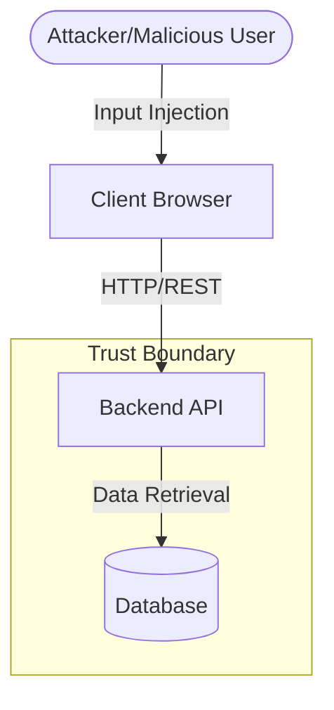

# THREAT MODEL

## Overview
This threat model covers the local World Monitor academic security lab.

## Architecture & Trust Boundaries

## Identified Threats (STRIDE)
1. **Spoofing**: Attackers forging user IDs (Demonstrated in VULN-001) due to lack of password authentication.
2. **Tampering**: Modifying API parameters to access unauthorized records (Demonstrated in VULN-002 IDOR).
3. **Repudiation**: Insufficient logging on the mock server.
4. **Information Disclosure**: Exposing internal user roles and secrets via profile endpoints (Demonstrated in VULN-007).
5. **Denial of Service**: Missing rate limiting on the `/api/login` endpoint.
6. **Elevation of Privilege**: Accessing `/api/admin` endpoints without server-side role validation (Demonstrated in VULN-003).

## Mitigations
- Enforce strict JWT/Session validation.
- Implement server-side ownership and role checks.
- Sanitize and encode all outputs to the client.
